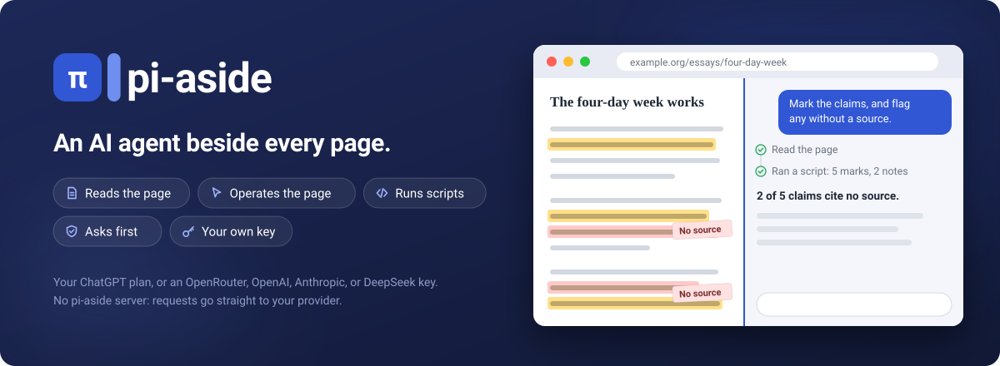
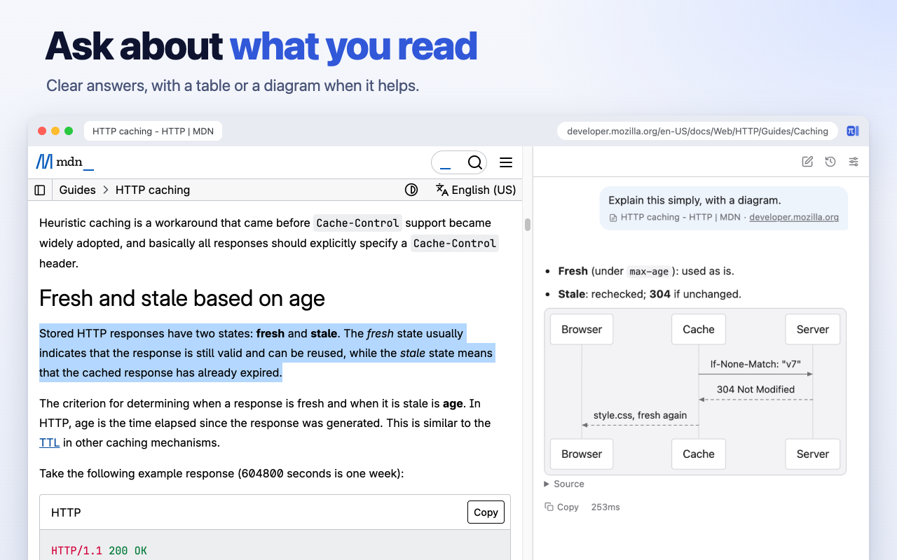
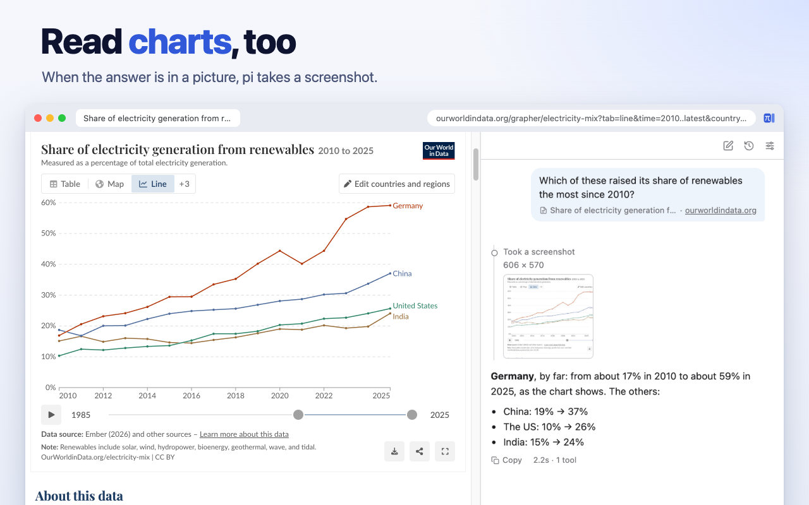
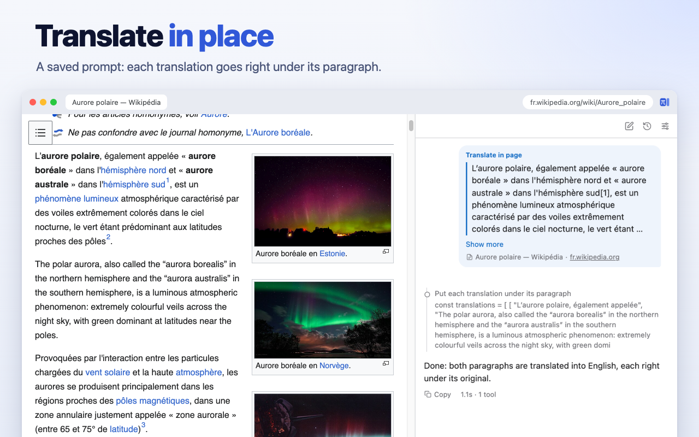
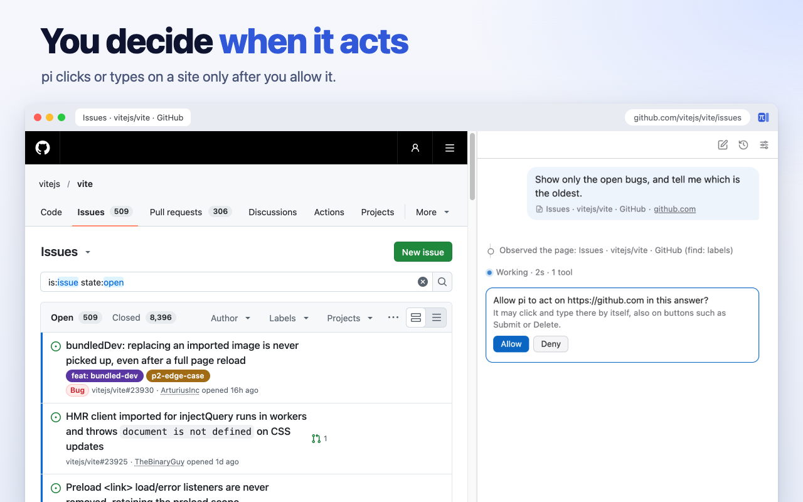

# pi-aside

English | [简体中文](README.zh-CN.md)



**An AI agent in Chrome's side panel.** Ask about the page you are on, or hand pi a task: it reads the page, clicks
and types, moves through a site and its tab group, runs scripts to pull out data, and shows you every step.

Use your ChatGPT plan, or your own OpenRouter, OpenAI, Anthropic, or DeepSeek API key. There is no pi-aside server:
requests go straight from your browser to your provider.

[Install](#install) · [Quick start](#quick-start) · [Examples](#examples)

## Why pi-aside

**What it can do**

- **It reads the page with you.** Select text or open pi on a page to summarize, explain, translate, proofread, or draft
  a reply. pi can also take a screenshot to read a chart, and you can paste or drop in an image or a text file, such as
  a CSV or a log. Answers can include tables, code, and diagrams.
- **It does tasks, not just answers.** pi clicks, types, picks options, and moves from page to page and across the tabs
  in your tab group. After each step it checks what happened, and it keeps going until the task is done.
- **It can program the page.** When clicking would be slow or impossible, pi writes a short script. It can rewrite the
  page in place (translate it, highlight what matters, add notes), collect every row of a long table or of many pages
  at once, fetch data from the site with your login, and work out exact answers from it. By default, you see the code
  before it runs.
- **Your prompts become one-click tools.** Save a task as a prompt and it appears in the right-click menu and as a
  `/command`, such as [translating a page in place](#translate-a-page-in-place) or
  [summarizing a YouTube video](#summarize-a-youtube-video).



**How it is different**

- **Tasks that keep going, built on pi-durable.** pi-aside runs on
  [pi-durable](https://www.npmjs.com/package/@earendil-works/pi-durable), the durable agent runtime from the pi project.
  Every step is saved in your browser as it happens, so a task goes on while you switch tabs or chats, several chats
  can work at once, and a task picks up again if Chrome stops pi's background worker.
- **Use your ChatGPT plan.** Sign in with ChatGPT and pi runs on the plan you already pay for: no API key, no
  per-token bill.
- **Guardrails in code, not just in the prompt.** pi asks before it acts on a site, shows a script's full code before
  it runs, never types into password, card, or one-time-code fields, refuses to click what something else covers, and
  stops a task's remaining steps once one fails. [More](#you-stay-in-control)
- **Your model, no middleman.** Four providers besides ChatGPT, a different model per message if you like, and each
  chat's cost shown as it grows. Open source (MIT), no analytics.

## Examples

Select text and right-click **Ask pi**, or press `Ctrl+Shift+Y` (`Cmd+Shift+Y` on a Mac), and ask about it. Or open pi
on any page and hand it a task, like the films table in the [animation above](#why-pi-aside).

<sub>The screenshots below show the real extension and its page tools on live sites. The model's replies in them are
scripted: results and timing vary by model.</sub>

### Explain a selection

*"Explain this simply, with a diagram."* With a paragraph of MDN's HTTP caching guide selected, pi answers in two lines
and draws what passes between the browser, the cache, and the server.



### Read a chart

*"Which of these raised its share of renewables the most since 2010?"* On a chart from Our World in Data, pi takes a
screenshot, reads the lines, and gives each country's change.



### More to try

- *"What are the 5 most popular stories of the past 24 hours?"* On Hacker News, pi writes one script that reads three
  pages and ranks the stories.
- *"Compare the three laptops in this tab group: price, weight, battery, and ports."* pi reads each tab and makes a
  table.
- *"Fill in this form from the details below, and stop before you submit."* pi types into each field and leaves the
  last click to you.
- *"I get this since upgrading to Vite 3. Is it a known issue? How do I fix it?"* With a screenshot of the error
  attached, pi searches the repository's issues, reads the one that matches, and says what fixes it.

### Saved prompts

A prompt can set a whole task, scripts included. Add one in Settings > Prompts, and it shows in the right-click menu
and as a `/command`. Both prompts below run scripts, so they need Allow User Scripts ([Quick start](#quick-start), step
4); choose **For this chat** on the script card, or set Run script to On, to skip the card next time.

#### Translate a page in place

Translation extensions usually send a page to a translation service piece by piece, so the same name or term can come
back translated three different ways. With this prompt, the model reads the whole page and translates it as one text,
then a script puts each translated paragraph under its original on the page.



Add it as "Translate in page", then right-click any article and choose **Translate in page**. `{{selection}}` is the
whole page when nothing is selected; select a few paragraphs first to translate only those. `{{language}}` is your
answer language (Settings > Answers).

<details>
<summary>The prompt</summary>

```text
Translate the text below into {{language}}, then embed the translation back into the original page, paragraph by paragraph: each translated paragraph right below its original. Keep the original text.

Style each translation as a plain paragraph in the page's own typography: no border, vertical line, quote formatting, background color, or other decoration.

{{selection}}
```

</details>

It is slower than a translation extension, but the translation reads as one piece, and with a ChatGPT plan it runs on
your plan instead of a per-token bill. A higher thinking level (the bulb in the message box) can give a more careful
translation, at the cost of more time.

#### Summarize a YouTube video

pi reads the video's full captions with one script, without opening the transcript panel, and answers from them. By
default it writes a summary: the main points first, then chapters whose timestamps open the video at that moment. To
catch the player's caption request, the script may turn captions off and on once; it leaves them as they were.

Add it as "Summarize video". On a video, right-click the page and choose **Summarize video**, or type
`/summarize-video`. A question after the command replaces the summary: `/summarize-video what does she say about
pricing?`

<details>
<summary>The prompt</summary>

```text
First check the tab's URL: {{url}}
If it is not a YouTube video page (www., m. or music.youtube.com with /watch?v= or /shorts/ followed by an ID), reply only with "Open a YouTube video in this tab, then run this again." in {{language}}, and stop: call no tools.
Otherwise, get the full captions of that video with run_script, then do this task from them: {{selection}}
If the task is empty or only says the whole page is attached, summarize the video. Do not use the "Show transcript" panel. Any caption language is fine.
Write ONE script that does all of this, read-only except for step 3:

1. Video ID from ?v= or the path after /shorts/; none: return {notVideo: true} and stop. If globalThis.piCaptions?.videoId is that ID, skip to step 6.
2. A caption request is usable if its URL contains "/api/timedtext" and "v=" + the ID, and its expire parameter (Unix seconds) is in the future. Look for the newest usable one in performance.getEntriesByType("resource").
3. If none (that buffer is often full or stale): start a PerformanceObserver with observe({type: "resource"}) that collects usable URLs; note whether .ytp-subtitles-button has aria-pressed="true"; if it was on, click it off and wait 300 ms; click it on; wait up to 6 s for a usable URL; disconnect; click again if needed so CC ends in the state you noted.
4. No usable URL: if the observer saw only expired ones, return {stalePlayer: true, toggledCC}; else return {capturedRequest: false, toggledCC}. Stop.
5. Take the usable URL, set fmt=json3, delete tlang, fetch it. Parse json3: for each event in events with segs, text = its segs' utf8 joined, trimmed; skip empty. Line = "[h:mm:ss] text" from tStartMs. Store globalThis.piCaptions = {videoId, language: the URL's lang, auto: kind === "asr", lines}. Empty or non-JSON body: return {status, bytes, hasPot: whether the URL has pot, toggledCC} and stop.
6. Return {videoId, language, auto, totalLines, from, to, toggledCC, text}, where text is lines from `from` joined by "\n", stopping before 30,000 characters.

Rules:
* Never return, log, or repeat the caption URL or any of its parameter values (signature, pot, ei, …).
* notVideo: give the same one-line reply as above. stalePlayer: tell me to reload the tab and try again. Other failures: report the returned fields. Do not guess captions.
* Video too long for one result: run short follow-up scripts that only read globalThis.piCaptions and return the next slice, until you have what the task needs. Do not fetch again.

How to write the answer (unless the task asks for another form). Readers scan, so put the point first:
* Start with "**In short:**" and one sentence on what the video is and who speaks, then 3–5 bullets with its main conclusions, most important first.
* Then "## Chapters", in order. Each heading: "### [12:34](LINK) " + the point as a short statement, e.g. "Open models let countries run their own AI", not a bare topic like "Open models". LINK is the tab's URL above, unchanged except t set to the start in seconds (t=754s), replacing any t it has. Under it, 1–3 bullets, one idea each, under 25 words, starting with who says it ("Huang:") when there are several speakers. Add the example or number that makes the point concrete. Where speakers disagree, give each side its own bullet. 5–10 chapters for an hour; merge topics that come back.
* Plain words, short sentences; explain a term once if the speakers rely on it. Report claims as the speaker's ("he argues"), without judging them. Keep names and titles as spoken; quote at most a short phrase. No tables, nested bullets, emoji, or filler such as "In this section". Bold at most one key phrase per chapter.
* End with "**Worth watching:**" 1–3 timestamp links to the parts most worth seeing in full, each with a few words on why.

Answer in {{language}}.
```

</details>

## Install

pi-aside is at version 0.1, an early release. It needs Chrome 140 or later.

**From a release:** download `pi-aside-<version>.zip` from
[Releases](https://github.com/yzhg1983/pi-aside/releases) and unzip it into a new folder. Open `chrome://extensions`,
turn on Developer mode, click **Load unpacked**, and choose that folder. To update, unzip the new version into the same
folder, replacing its files, and press the reload icon on pi-aside's card. Keep the folder where it is: Chrome treats a
folder in another place as another extension, without your settings, keys, and chats.

**From source** (Node.js 22.19+):

```sh
git clone https://github.com/yzhg1983/pi-aside
cd pi-aside
npm ci --ignore-scripts   # dependencies, without install scripts
npm run build             # writes dist/
```

Load the `dist/` folder as above. To update, pull, build again, and press the reload icon on pi-aside's card;
settings, keys, and chats are kept.

## Quick start

1. Click pi-aside's toolbar button, or press `Ctrl+Shift+U` (`Cmd+Shift+U` on a Mac).
2. Pick a provider, paste an API key, and Save; allow access when Chrome asks. For a ChatGPT plan, choose OpenAI, then
   **Continue with ChatGPT**.
3. Select text and right-click **Ask pi**, or type a task in the message box.
4. Optional, for scripts: turn on **Allow User Scripts** on pi-aside's Chrome details page (Settings > Tools links to
   it).

## You stay in control

Settings > Tools turns each tool (read, observe, act, run script, screenshot) Off or On; acting and running scripts
can also Ask. Out of the box, acting on a page and running scripts ask first.



**Enforced by pi-aside, whatever the model says:**

- In Ask, pi needs your OK once per site in each answer before it acts, and shows every script in full before it runs.
- If Chrome stops pi in the middle of a click or a script, pi does not repeat it: the model is told it may have
  happened and to check the page first. Steps that are harmless to repeat, such as reading the page, simply run
  again ([details](docs/guide.md#when-chrome-stops-pi)).
- pi reads a tab only after you open it there, or on a site you allowed.
- It goes only to pages of the current site, unless you allow another.
- It never types into password, payment card, or one-time code fields, and leaves typed form values out of what it
  reads.
- Every step shows in the chat. Stop, or Esc, ends the task. A message you send while pi works joins the task after
  its current step, so you can correct it on the way; Alt+Enter sends it after the answer instead (Settings > Sending
  swaps the two).

**Asked of the model, not enforced:** confirm before submitting, sending, deleting, buying, or downloading; never enter
payment details; ignore commands written on web pages.

**What remains:** pi acts as you, with your login. A page can hide text written to mislead it, and models make
mistakes. Keep Ask for email, banking, admin pages, and anywhere a wrong click matters.

## Privacy

- No pi-aside server and no analytics. Requests go straight to the provider you choose.
- Chats, settings, and keys stay in your Chrome profile. Keys are stored unencrypted there.
- Chats are kept until you delete them all (Settings > Advanced > Data). Details: [PRIVACY.md](PRIVACY.md).

## Learn more

- [User guide](docs/guide.md): images and text files, chats and History, prompts and slash commands, models and
  thinking, editing a question, diagrams, web search, shortcuts, languages, and limits.
- [CONTRIBUTING.md](CONTRIBUTING.md): building, checks, and tests.

pi-aside is unofficial: the pi project, which makes pi-durable, does not make or endorse it.

## License

[MIT](LICENSE). Bundled packages keep their own licences, listed in `dist/THIRD_PARTY_NOTICES.txt` by each build.
