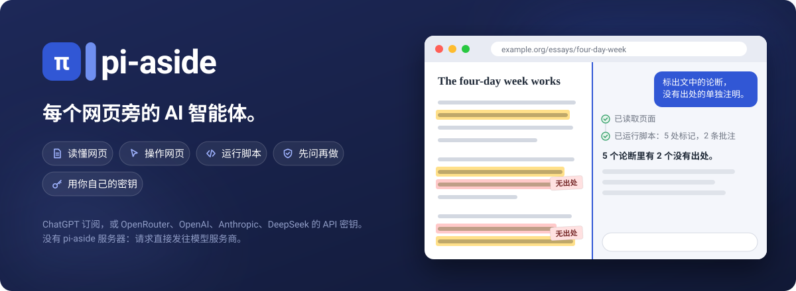
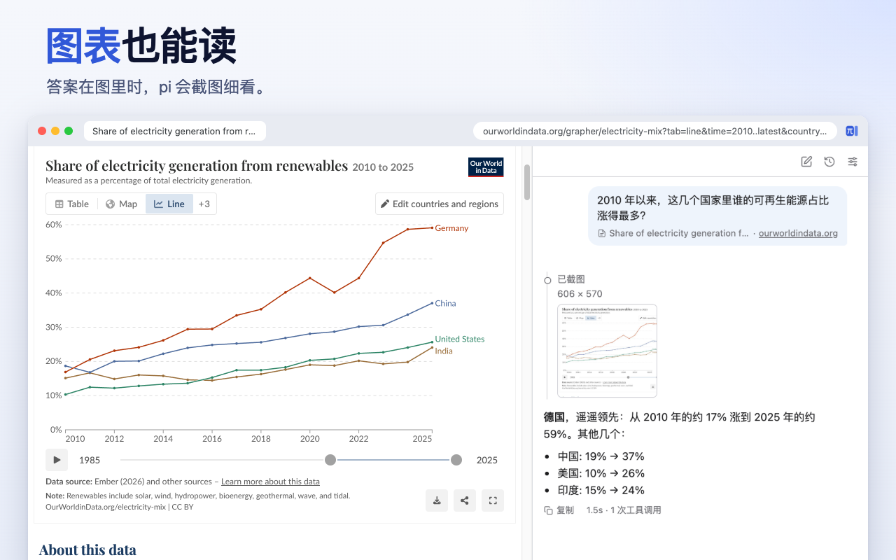
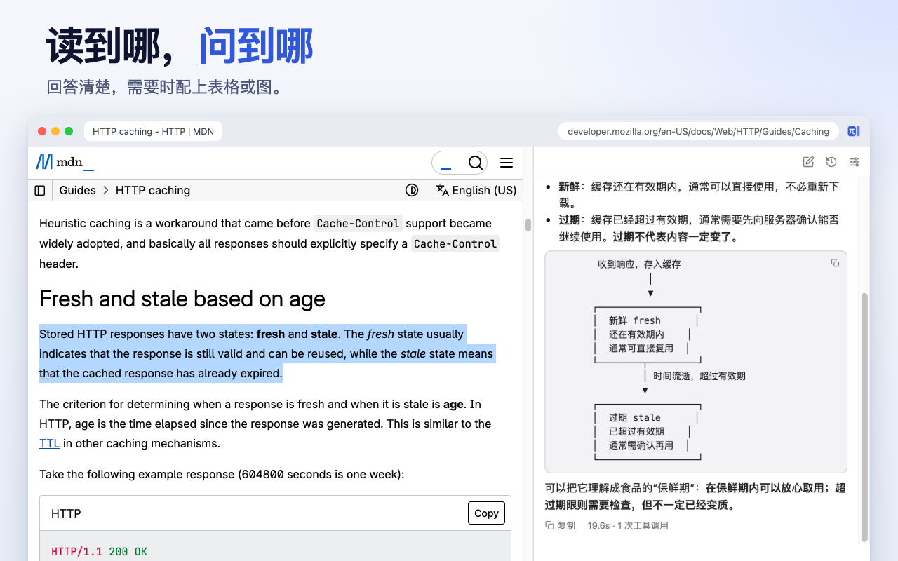
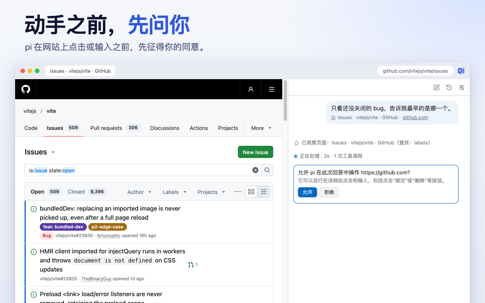

# pi-aside

[English](README.md) | 简体中文



**Chrome 侧边栏里的 AI 智能体。** 对着正在看的网页提问，或者直接把任务交给 pi：它会读页面、点按钮、填表单，在网站的各个页面和标签页组之间来回切换，必要时还会现写脚本抓取数据。每一步做了什么，都摆在你眼前。

可以用你的 ChatGPT 订阅，也可以填 OpenRouter、OpenAI、Anthropic 或 DeepSeek 的 API 密钥。pi-aside 没有自己的服务器，请求从浏览器直接发往模型服务商。

## 为什么选 pi-aside

**能做什么**

- **陪你一起读网页。** 选中一段文字，或者在当前页面打开 pi，就能让它总结、解释、翻译、润色，或者帮你拟一段回复。遇到图表，它会截图来看；你也可以粘贴或拖入图片、文本文件（比如 CSV、日志）一起问。回答里可以带表格、代码和图示。
- **不只回答，还能动手。** 点击、输入、选下拉项、翻页、切换标签页组里的其他标签页，pi 都能自己完成。每做一步都会核对结果，直到把事情办完。
- **能给网页写脚本。** 点来点去太慢、甚至根本做不到的事，pi 会现写一段短脚本：直接在原网页上翻译、标重点、加批注；一次抓下长表格或多页列表里的全部数据；借你的登录状态从网站取数据，再算出准确结果。默认情况下，脚本运行前你会先看到完整代码。
- **常用任务，一键调用。** 把常做的任务存成提示词，它就会出现在右键菜单里，也能在输入框里用 `/命令` 调出来，比如下面的[页面内翻译](#页面内翻译)和 [YouTube 视频总结](#youtube-视频总结)。



**有何不同**

- **基于 pi-durable，任务不怕中断。** pi-aside 构建在 pi 项目的持久化智能体运行时 [pi-durable](https://www.npmjs.com/package/@earendil-works/pi-durable) 之上。每一步都会实时存进浏览器：切到别的标签页或对话，任务照常进行；几个对话可以同时干活；即使 Chrome 中途停掉了 pi 的后台进程，任务也能接着做完。
- **直接用 ChatGPT 订阅。** 用 ChatGPT 账号登录，就能用上你已经付费的套餐：不需要 API 密钥，也不按 token 计费。
- **护栏写在代码里，不只写在提示词里。** 在一个网站上动手之前，pi 会先征得你的同意；脚本运行前会展示完整代码；密码、银行卡、一次性验证码这类输入框一律不碰；被其他元素挡住的地方不点；某一步出了错，后面的步骤随即停下。[详情](#由你掌控)
- **模型由你选，没有中间商。** 除了 ChatGPT，还支持另外四家服务商；每条消息都可以换模型，每个对话花了多少钱随时看得到。代码开源（MIT），不做任何使用统计。

## 可以这样问

- *“这些电影是哪年上映的？按年代画张图，并把 2020 年代的标出来。”* 在维基百科的全球最高票房电影列表上，一段脚本统计每一行并在页面上标出那些行，pi 再画出图表。
- *“升级到 Vite 3 后出现这个报错。是已知问题吗？怎么解决？”* 附上报错截图，pi 在仓库的 issue 里搜索，读完对应的那条，说明怎样解决。
- *“过去 24 小时最热门的 5 条新闻是哪些？”* 在 Hacker News 上，pi 写一段脚本连读三页，排出前五。
- *“这几个国家里，2010 年以来哪个的可再生能源占比涨得最多？”* 面对一张图表，pi 会截图来读。
- *“对比一下这个标签页组里的三台笔记本：价格、重量、续航和接口。”* pi 逐个读取标签页，整理成一张表。
- *“这个仓库里有哪些标了 bug、还没人回复的 issue？按时间从早到晚排。”* 在 GitHub 仓库页面上，pi 先设好筛选条件，再把列表读出来。
- *“按下面的信息填好这张表单，提交前停下。”* pi 逐项填写，最后那一下提交留给你自己点。



也可以直接问：选中文字后右键点 **询问 pi**，或者按 `Ctrl+Shift+Y`（Mac 上是 `Cmd+Shift+Y`）。



<sub>截图展示的是真实的扩展和网页工具，页面为线上实时页面；其中模型的回复为预设内容，实际效果和耗时因模型而异。</sub>

## 提示词示例

一条提示词可以交代一整件任务，连脚本一起。在 设置 > 提示词 里添加后，它会出现在右键菜单里，也能用 `/命令` 调用。下面两个示例都要运行脚本，所以需要先开启“允许用户脚本”（见[快速上手](#快速上手)第 4 步）；在脚本卡片上选 **本次对话**，或者把“运行脚本”设为开启，下次就不用再确认。

### 页面内翻译

常见的翻译插件会把网页拆成一段一段分别送去翻译，结果同一个人名或术语，前后可能出现三种译法。这条提示词换了个做法：先让模型通读整页、当作一篇文章来翻，再用脚本把每段译文插到对应原文的正下方。

添加一条提示词，命名为“页面内翻译”：

```text
把下面的内容译成中文，再逐段放回原网页：每段译文紧跟在对应的原文段落下方，保留原文。

译文使用网页正文的普通段落样式，不要加左边框、竖线、引用样式、背景色或其他装饰。

{{selection}}
```

之后在任意文章上右键，选 **页面内翻译** 即可。没有选中文字时，`{{selection}}` 就是整个页面；先选中几段，就只翻译这几段。想译成别的语言，把“中文”换掉就行。

它比翻译插件慢，但译文前后统一，读起来连贯；用 ChatGPT 订阅时，走的是套餐额度，不按 token 计费。把输入框里的“思考”档位（灯泡图标）调高，译文会更用心，只是要多等一会儿。

### YouTube 视频总结

pi 用一段脚本读出视频的完整字幕（不用打开“显示文字记录”面板），再根据字幕作答。默认会写一份总结：先列要点，再按章节展开，每个时间戳都能直接跳到视频里对应的位置。为了截到播放器的字幕请求，脚本可能会把字幕关掉再打开一次，结束时恢复原样。

添加一条提示词，命名为“视频总结”。打开一个视频，在页面上右键选 **视频总结**，或者输入 `/视频总结`。命令后面跟一个问题，就会改为回答这个问题，比如 `/视频总结 她对定价怎么看？`。提示词是英文写的，回答语言跟随 设置 > 回答。

<details>
<summary>提示词全文</summary>

```text
First check the tab's URL: {{url}}
If it is not a YouTube video page (www., m. or music.youtube.com with /watch?v= or /shorts/ followed by an ID), reply only with "Open a YouTube video in this tab, then run this again." in {{language}}, and stop: call no tools.
Otherwise, get the full captions of that video with run_script, then do this task from them: {{selection}}
If the task is empty or only says the whole page is attached, summarize the video. Do not use the "Show transcript" panel. Any caption language is fine.
Write ONE script that does all of this, read-only except for step 3:

1. Video ID from ?v= or the path after /shorts/; none: return {notVideo: true} and stop. If globalThis.piCaptions?.videoId is that ID, skip to step 6.
2. A caption request is usable if its URL contains "/api/timedtext" and "v=" + the ID, and its expire parameter (Unix seconds) is in the future. Look for the newest usable one in performance.getEntriesByType("resource").
3. If none (that buffer is often full or stale): start a PerformanceObserver with observe({type: "resource"}) that collects usable URLs; note whether .ytp-subtitles-button has aria-pressed="true"; if it was on, click it off and wait 300 ms; click it on; wait up to 6 s for a usable URL; disconnect; click again if needed so CC ends in the state you noted.
4. No usable URL: if the observer saw only expired ones, return {stalePlayer: true, toggledCC}; else return {capturedRequest: false, toggledCC}. Stop.
5. Take the usable URL, set fmt=json3, delete tlang, fetch it. Parse json3: for each event in events with segs, text = its segs' utf8 joined, trimmed; skip empty. Line = "[h:mm:ss] text" from tStartMs. Store globalThis.piCaptions = {videoId, language: the URL's lang, auto: kind === "asr", lines}. Empty or non-JSON body: return {status, bytes, hasPot: whether the URL has pot, toggledCC} and stop.
6. Return {videoId, language, auto, totalLines, from, to, toggledCC, text}, where text is lines from `from` joined by "\n", stopping before 30,000 characters.

Rules:
* Never return, log, or repeat the caption URL or any of its parameter values (signature, pot, ei, …).
* notVideo: give the same one-line reply as above. stalePlayer: tell me to reload the tab and try again. Other failures: report the returned fields. Do not guess captions.
* Video too long for one result: run short follow-up scripts that only read globalThis.piCaptions and return the next slice, until you have what the task needs. Do not fetch again.

How to write the answer (unless the task asks for another form). Readers scan, so put the point first:
* Start with "**In short:**" and one sentence on what the video is and who speaks, then 3–5 bullets with its main conclusions, most important first.
* Then "## Chapters", in order. Each heading: "### [12:34](LINK) " + the point as a short statement, e.g. "Open models let countries run their own AI", not a bare topic like "Open models". LINK is the tab's URL above, unchanged except t set to the start in seconds (t=754s), replacing any t it has. Under it, 1–3 bullets, one idea each, under 25 words, starting with who says it ("Huang:") when there are several speakers. Add the example or number that makes the point concrete. Where speakers disagree, give each side its own bullet. 5–10 chapters for an hour; merge topics that come back.
* Plain words, short sentences; explain a term once if the speakers rely on it. Report claims as the speaker's ("he argues"), without judging them. Keep names and titles as spoken; quote at most a short phrase. No tables, nested bullets, emoji, or filler such as "In this section". Bold at most one key phrase per chapter.
* End with "**Worth watching:**" 1–3 timestamp links to the parts most worth seeing in full, each with a few words on why.

Answer in {{language}}.
```

</details>

## 安装

pi-aside 目前是 0.1 版，还处在早期阶段，需要 Chrome 140 或更高版本。

**从发布版安装：** 在 [Releases](https://github.com/yzhg1983/pi-aside/releases) 下载 `pi-aside-<版本号>.zip`，解压到一个新文件夹。打开 `chrome://extensions`，开启右上角的“开发者模式”，点 **加载已解压的扩展程序**，选中这个文件夹。以后更新时，把新版本解压到同一个文件夹、覆盖原有文件，再点一下 pi-aside 卡片上的刷新按钮。请不要移动这个文件夹：换了位置，Chrome 会把它当成另一个扩展，原来的设置、密钥和对话记录都不会跟过去。

**从源码安装**（需要 Node.js 22.19+）：

```sh
git clone https://github.com/yzhg1983/pi-aside
cd pi-aside
npm ci --ignore-scripts   # 安装依赖，跳过安装脚本
npm run build             # 构建到 dist/
```

按上面的方法加载 `dist/` 文件夹。以后更新时，拉取最新代码、重新构建，再点一下 pi-aside 卡片上的刷新按钮即可，设置、密钥和对话记录都会保留。

## 快速上手

1. 点工具栏上的 pi-aside 图标，或者按 `Ctrl+Shift+U`（Mac 上是 `Cmd+Shift+U`）。
2. 选一家服务商，粘贴 API 密钥后保存；Chrome 请求访问权限时点允许。想用 ChatGPT 订阅，就选 OpenAI，再点 **使用 ChatGPT 继续**。
3. 选中文字后右键点 **询问 pi**，或者直接在输入框里写下要做的事。
4. 可选，要用脚本时：在 Chrome 的 pi-aside 扩展详情页里打开 **允许用户脚本**（设置 > 工具 里有直达链接）。

## 由你掌控

在 设置 > 工具 里，每个工具（读取页面、观察页面、操作页面、运行脚本、截取页面）都可以设为关闭或开启，操作页面和运行脚本还可以设为询问。默认情况下，操作页面和运行脚本都会先问过你。



**无论模型怎么说，pi-aside 都会守住这些底线：**

- 在“询问”模式下，每次回答里 pi 第一次在某个网站上动手之前，都要先经你同意；每段脚本运行前，都会完整展示代码。
- 如果 Chrome 在点击或脚本执行到一半时停掉了 pi，pi 不会重做这一步，而是告诉模型这一步可能已经生效，让它先检查页面。读取页面这类重做一次也无妨的步骤，则会直接重新执行（详见[用户指南](docs/guide.md#when-chrome-stops-pi)，英文）。
- 只有你在某个标签页上打开过 pi，或者该网站已经被你允许，pi 才会读取这个标签页。
- pi 只在当前网站内跳转，除非你允许它去别的网站。
- 密码、银行卡、一次性验证码输入框，pi 绝不往里输入；读取页面时，也会略去你在表单里填写的内容。
- 每一步都会显示在对话里，随时可以点“停止”或按 Esc 结束任务。pi 工作时你发出的消息，会在当前步骤完成后并入任务，方便你中途纠正；按 Alt+Enter 则会等回答结束后再发送（可在 设置 > 发送 里互换两者）。

**只能要求、无法强制：** 提交、发送、删除、购买或下载之前先向你确认；绝不填写支付信息；不理会网页上写给它的指令。

**仍需留意：** pi 以你的身份、凭你的登录状态操作。网页里可能藏着故意误导它的文字，模型也难免出错。在邮箱、网银、管理后台，以及任何点错就麻烦的地方，请保持“询问”模式。

## 隐私

- 没有 pi-aside 服务器，也不做任何使用统计；请求直接发往你选择的服务商。
- 对话、设置和密钥都保存在你的 Chrome 个人资料里，其中密钥没有加密。
- 对话会一直保留，直到你在 设置 > 高级 > 数据 里全部删除。详见 [PRIVACY.md](PRIVACY.md)（英文）。

## 了解更多

- [用户指南](docs/guide.md)（英文）：图片与文本文件、对话与历史记录、提示词与斜杠命令、模型与思考、编辑提问、图示、联网搜索、快捷键、语言和使用限制。
- [CONTRIBUTING.md](CONTRIBUTING.md)（英文）：构建、检查与测试。
- [Issues](https://github.com/yzhg1983/pi-aside/issues)：反馈问题、提出疑问。

pi-aside 是非官方项目：开发 pi-durable 的 pi 项目既没有参与开发，也没有为它背书。

## 许可证

[MIT](LICENSE)。打包进来的第三方依赖沿用各自的许可证，每次构建都会把它们列在 `dist/THIRD_PARTY_NOTICES.txt` 里。
